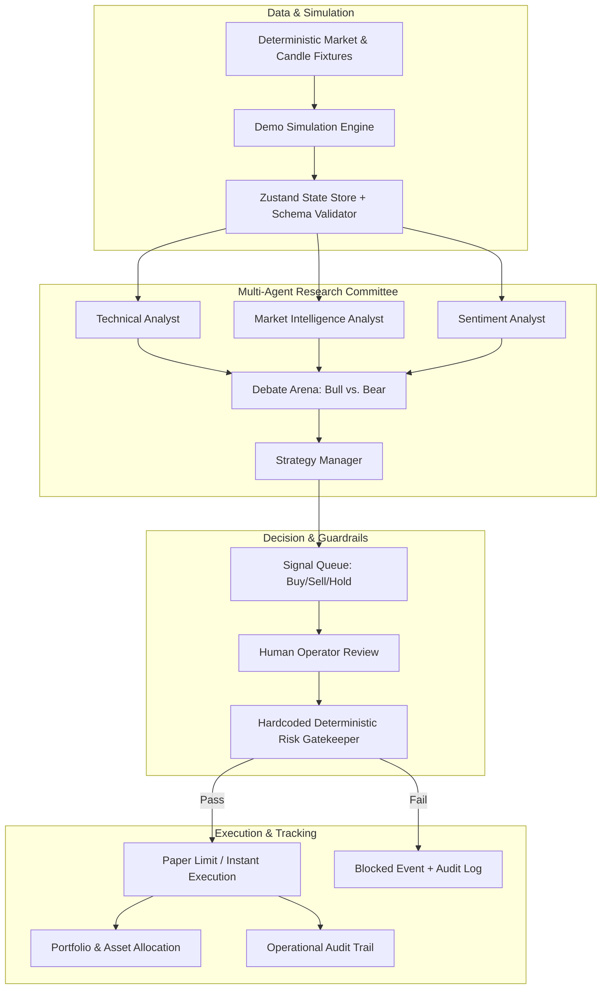

<div align="center">


# CRYPTO AI — MISSION CONTROL
### *Intelligent Markets. Coordinated Agents. Controlled Decisions.*

<p>
  <a href="https://cryptoai.syahmiaof.my"></a>
  <a href="https://github.com/syahmiaof/crypto-agent"></a>
  <a href="LICENSE"></a>
  <a href="https://syahmiaof.my"></a>
</p>

<p>
  
  
  
  
  
  
  
  
</p>

<p align="center">
  <b>An institutional-grade multi-agent cryptocurrency intelligence terminal, algorithmic strategy laboratory, and simulated execution command center.</b>
</p>

[**Explore Live Terminal**](https://cryptoai.syahmiaof.my) • [**Features**](#-key-features) • [**Architecture**](#%EF%B8%8F-system-architecture) • [**Modules**](#%EF%B8%8F-completed-modules-10-pages) • [**Technology Stack**](#%EF%B8%8F-tech-stack)

---

</div>

## 📌 Overview

- **Functionality**: Multi-agent algorithmic cryptocurrency intelligence terminal, strategy backtesting sandbox, and paper execution command center with 7 specialized LLM analysts.
- **Aesthetic Value**: High-density institutional trading terminal combining interactive TradingView charts, real-time agent debate arenas, and cohesive cyberpunk design tokens.
- **Business Value**: Eliminates unconstrained AI trading risk by isolating generative LLM debate behind deterministic, non-bypassable mathematical risk gatekeepers and global emergency stops.

> [!IMPORTANT]
> **Environment Note:** This software operates in **Simulated Paper Trading Mode** with deterministic market fixtures. No real capital, private keys, or external exchange execution APIs are connected by default.

---

## ⚡ Key Features

- 📊 **Institutional Trading Terminal**: High-performance interactive candlestick charts powered by TradingView Lightweight Charts, featuring multi-timeframe OHLCV inspection (15M, 1H, 4H, 1D, 1W), EMA overlays, and dynamic signal entry/exit markers.
- 🤖 **AI Agent War Room**: Real-time operational dashboard for 7 specialized research and risk agents, featuring a three-column **Debate Arena** (Bull vs. Bear arguments, shared consensus, and invalidation rules).
- 🛡️ **Deterministic Risk Engine**: Hardcoded quantitative checks that automatically enforce maximum position sizing, aggregate portfolio exposure, daily loss thresholds, drawdown caps, and mandatory trade cooldown timers.
- 🛑 **Global Emergency Stop**: One-click circuit breaker to immediately pause all order flow and queue allocations across the entire platform.
- 💼 **Coherent Paper Portfolio**: Real-time equity tracking with an initial 10,000 USDT virtual allocation, tracking open positions, unrealized/realized P&L, and asset distribution curves.
- 🧪 **Quantitative Strategy Lab**: Interactive backtest and sensitivity modeling environment for classic algorithms (Trend Following, EMA Crossover, RSI Reversion, Breakout Confirmation) with customizable fees and slippage models.
- 💬 **Context-Aware AI Assistant**: Ask questions about portfolio state, signal rationales, or market catalysts backed by deterministic local fixtures.
- 📜 **Full Operational Audit Trail**: Every signal approval, risk violation, emergency stop, and parameter modification is recorded into a persistent, searchable audit timeline.
- ⌨️ **Command Palette (`Ctrl+K` / `Cmd+K`)**: Rapid keyboard-driven navigation across all markets, pages, and terminal assets.

---

## 🏛️ System Architecture



---

## 🗂️ Completed Modules (10 Pages)

| Page | Route | Description |
|---|---|---|
| **Mission Control Overview** | [`/dashboard`](https://cryptoai.syahmiaof.my/dashboard) | Flagship cockpit: 6 KPI strips, BTC/USDT candlestick chart, Market Pulse watchlist, and Active Signals. |
| **Smart Market Terminal** | [`/markets`](https://cryptoai.syahmiaof.my/markets) | Dedicated charting workspace with simulated order books, depth charts, and trade execution tables. |
| **AI Agent War Room** | [`/agents`](https://cryptoai.syahmiaof.my/agents) | Multi-agent coordination matrix, lifecycle controls (pause/resume), and the Bull vs. Bear Debate Arena. |
| **AI Signal Center** | [`/signals`](https://cryptoai.syahmiaof.my/signals) | Actionable signal review drawer, R/R calculations, technical evidence breakdown, and paper order creation. |
| **Portfolio & Paper Trading** | [`/portfolio`](https://cryptoai.syahmiaof.my/portfolio) | 10,000 USDT virtual capital dashboard, asset allocation meters, equity growth curve, and position close tools. |
| **Strategy Lab** | [`/strategies`](https://cryptoai.syahmiaof.my/strategies) | Algorithmic strategy backtesting sandbox, fee/slippage modeling, drawdown curves, and trade ledgers. |
| **Risk Control Center** | [`/risk`](https://cryptoai.syahmiaof.my/risk) | Real-time exposure gauges, editable risk thresholds, permitted asset allowlists, and the Emergency Stop switch. |
| **Ask Your Trading AI** | [`/assistant`](https://cryptoai.syahmiaof.my/assistant) | Conversational intelligence workspace with suggested starter prompts and linked portfolio context. |
| **Activity & Audit Log** | [`/activity`](https://cryptoai.syahmiaof.my/activity) | Complete operational timeline with multi-criteria filtering (date, event type, severity, entity ID). |
| **Settings & Integrations** | [`/settings`](https://cryptoai.syahmiaof.my/settings) | Visual preferences (density, reduced motion, number formats), exchange placeholders, and factory demo reset. |

---

## 🛠️ Tech Stack

- **Framework**: Next.js 16 (App Router, Turbopack)
- **Language**: TypeScript (Strict Mode)
- **UI & Primitives**: Radix UI, Lucide React, Geist Fonts
- **Styling**: Tailwind CSS v4
- **Charts**: TradingView Lightweight Charts v5, Recharts v3
- **State Management**: Zustand v5 with validation guards and persistence
- **Testing**: Vitest, Playwright, Testing Library
- **Deployment**: Vercel Edge Network with Cloudflare DNS

---

## 🧪 Testing & Quality Assurance

The codebase maintains automated test suites covering domain calculations, deterministic risk gatekeeping rules, end-to-end user journeys, and visual regressions validated continuously through GitHub Actions CI.

---

## 📂 Repository Structure

```
crypto-agent/
├── app/                  # Next.js App Router (10 pages + layout + error boundaries)
│   ├── dashboard/        # Mission Control Overview
│   ├── markets/          # Smart Market Terminal
│   ├── agents/           # AI Agent War Room
│   ├── signals/          # AI Signal Center
│   ├── portfolio/        # Portfolio & Paper Trading
│   ├── strategies/       # Strategy Lab
│   ├── risk/             # Risk Control Center
│   ├── assistant/        # AI Assistant Workspace
│   ├── activity/         # Activity & Audit Logs
│   └── settings/         # Settings & Integrations
├── components/           # Reusable UI component systems
│   ├── agents/           # Intelligence panels & debate widgets
│   ├── assistant/        # Chat workspace & context feeds
│   ├── layout/           # AppShell, Topbar, Sidebar, Command Palette
│   ├── portfolio/        # Order workspaces & allocation meters
│   ├── shared/           # Analytics charts & MarketPulse
│   ├── trading/          # Lightweight charts, signal tables & snapshots
│   └── ui/               # Semantic primitives (Metric, Panel, Badge, Dialog)
├── data/                 # Deterministic mock fixtures & market seeds
├── features/             # Feature-level page orchestrators
├── lib/                  # Quantitative math, risk validators & backtest engines
├── public/               # Static assets & OpenGraph banners
├── store/                # Shared Zustand application store
├── tests/                # Automated unit, integration & E2E tests
│   └── e2e/              # Playwright journey & visual regression specs
└── types/                # TypeScript domain contracts
```

---

## 🔒 Security & Risk Notice

- **No Real Capital at Risk**: This application is strictly an educational, research, and simulation platform.
- **API Key Security**: Never hardcode private keys, seed phrases, or exchange withdrawal API keys into client code or version control.
- **Deterministic Rules**: Real automated execution systems should always isolate trade execution behind cryptographically restricted keys with external hardware or server-side circuit breakers.

---

## 📄 License

Copyright (c) 2026 Muhammad Syahmi ([syahmiaof](https://syahmiaof.my)). All rights reserved.  
Proprietary source code created solely for demonstration and portfolio showcase purposes.

---

<div align="center">
  <sub>Built with precision by <a href="https://github.com/syahmiaof">Muhammad Syahmi</a> • Production Live at <a href="https://cryptoai.syahmiaof.my">cryptoai.syahmiaof.my</a></sub>
</div>
