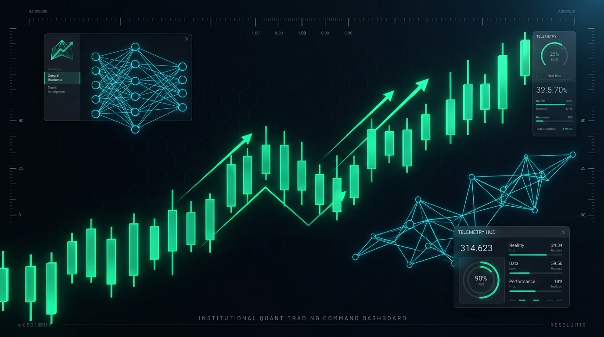
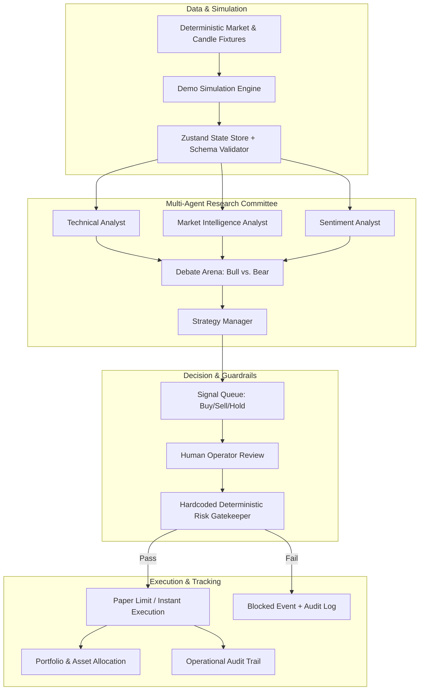

<div align="center">



# CRYPTO AI — MISSION CONTROL
### *Intelligent Markets. Coordinated Agents. Controlled Decisions.*

[](https://cryptoai.syahmiaof.my)
[](./LICENSE)
[](https://nextjs.org/)
[](https://react.dev/)
[](https://www.typescriptlang.org/)
[](https://tailwindcss.com/)
[](https://github.com/syahmiaof/crypto-agent/actions)

<p align="center">
  <b>An institutional-grade multi-agent cryptocurrency intelligence terminal, algorithmic strategy laboratory, and simulated execution command center.</b>
</p>

[**Explore Live Terminal**](https://cryptoai.syahmiaof.my) • [**Features**](#key-features) • [**Architecture**](#system-architecture) • [**Modules**](#completed-modules-10-pages) • [**Quick Start**](#getting-started) • [**Contributing**](#contributing)

---

</div>

## 📌 Overview

**Crypto AI — Mission Control** bridges the gap between autonomous multi-agent quantitative intelligence and deterministic risk management. 

Instead of treating Large Language Models (LLMs) as fragile direct market-execution triggers, Mission Control deploys a **specialized multi-agent committee** (Technical, Sentiment, Market Intelligence, Bull/Bear Advocates, and Strategy Managers) tasked with evidence synthesis, debate, and signal generation — protected by **hardcoded, non-bypassable quantitative risk guardrails**.

> [!IMPORTANT]
> **Environment Note:** This software operates in **Simulated Paper Trading Mode** with deterministic market fixtures. No real capital, private keys, or external exchange execution APIs are connected by default.

---

## ⚡ Key Features

- 📊 **Institutional Trading Terminal**: High-performance interactive candlestick charts powered by TradingView Lightweight Charts, featuring multi-timeframe OHLCV inspection (15M, 1H, 4H, 1D, 1W), EMA overlays, and dynamic signal entry/exit markers.
- 🤖 **AI Agent War Room**: Real-time operational dashboard for 7 specialized research and risk agents, featuring a three-column **Debate Arena** (Bull vs. Bear arguments, shared consensus, and invalidation rules).
- 🛡️ **Deterministic Risk Engine**: Hardcoded quantitative checks that automatically enforce maximum position sizing, aggregate portfolio exposure, daily loss thresholds, drawdown caps, and mandatory trade cooldown timers.
- 🛑 **Global Emergency Stop**: One-click circuit breaker to immediately pause all order flow and queue allocations across the entire platform.
- 💼 **Coherent Paper Portfolio**: Real-time equity tracking with an initial 10,000 USDT virtual allocation, tracking open positions, unrealized/realized P&L, and asset distribution curves.
- 🧪 **Quantitative Strategy Lab**: Interactive backtest and sensitivity modeling environment for classic algorithms (Trend Following, EMA Crossover, RSI Reversion, Breakout Confirmation) with customizable fees and slippage models.
- 💬 **Context-Aware AI Assistant**: Ask questions about portfolio state, signal rationales, or market catalysts backed by deterministic local fixtures.
- 📜 **Full Operational Audit Trail**: Every signal approval, risk violation, emergency stop, and parameter modification is recorded into a persistent, searchable audit timeline.
- ⌨️ **Command Palette (`Ctrl+K` / `Cmd+K`)**: Rapid keyboard-driven navigation across all markets, pages, and terminal assets.

---

## 🏛️ System Architecture



---

## 🗂️ Completed Modules (10 Pages)

| Page | Route | Description |
|---|---|---|
| **Mission Control Overview** | [`/dashboard`](https://cryptoai.syahmiaof.my/dashboard) | Flagship cockpit: 6 KPI strips, BTC/USDT candlestick chart, Market Pulse watchlist, and Active Signals. |
| **Smart Market Terminal** | [`/markets`](https://cryptoai.syahmiaof.my/markets) | Dedicated charting workspace with simulated order books, depth charts, and trade execution tables. |
| **AI Agent War Room** | [`/agents`](https://cryptoai.syahmiaof.my/agents) | Multi-agent coordination matrix, lifecycle controls (pause/resume), and the Bull vs. Bear Debate Arena. |
| **AI Signal Center** | [`/signals`](https://cryptoai.syahmiaof.my/signals) | Actionable signal review drawer, R/R calculations, technical evidence breakdown, and paper order creation. |
| **Portfolio & Paper Trading** | [`/portfolio`](https://cryptoai.syahmiaof.my/portfolio) | 10,000 USDT virtual capital dashboard, asset allocation meters, equity growth curve, and position close tools. |
| **Strategy Lab** | [`/strategies`](https://cryptoai.syahmiaof.my/strategies) | Algorithmic strategy backtesting sandbox, fee/slippage modeling, drawdown curves, and trade ledgers. |
| **Risk Control Center** | [`/risk`](https://cryptoai.syahmiaof.my/risk) | Real-time exposure gauges, editable risk thresholds, permitted asset allowlists, and the Emergency Stop switch. |
| **Ask Your Trading AI** | [`/assistant`](https://cryptoai.syahmiaof.my/assistant) | Conversational intelligence workspace with suggested starter prompts and linked portfolio context. |
| **Activity & Audit Log** | [`/activity`](https://cryptoai.syahmiaof.my/activity) | Complete operational timeline with multi-criteria filtering (date, event type, severity, entity ID). |
| **Settings & Integrations** | [`/settings`](https://cryptoai.syahmiaof.my/settings) | Visual preferences (density, reduced motion, number formats), exchange placeholders, and factory demo reset. |

---

## 🛠️ Tech Stack

- **Framework**: [Next.js 16](https://nextjs.org/) (App Router, Turbopack)
- **Language**: [TypeScript](https://www.typescriptlang.org/) (Strict Mode)
- **UI & Primitives**: [Radix UI](https://www.radix-ui.com/), [Lucide React](https://lucide.dev/), [Geist Fonts](https://vercel.com/font)
- **Styling**: [Tailwind CSS v4](https://tailwindcss.com/)
- **Charts**: [TradingView Lightweight Charts v5](https://tradingview.github.io/lightweight-charts/), [Recharts v3](https://recharts.org/)
- **State Management**: [Zustand v5](https://github.com/pmndrs/zustand) with validation guards and persistence
- **Testing**: [Vitest](https://vitest.dev/), [Playwright](https://playwright.dev/), [Testing Library](https://testing-library.com/)
- **Deployment**: [Vercel](https://vercel.com/) Edge Network with [Cloudflare DNS](https://www.cloudflare.com/)

---

## 🚀 Getting Started

### Prerequisites

- [Node.js](https://nodejs.org/) v20+ 
- [npm](https://www.npmjs.com/) or [pnpm](https://pnpm.io/)

### Installation

1. **Clone the repository**:
   ```bash
   git clone https://github.com/syahmiaof/crypto-agent.git
   cd crypto-agent
   ```

2. **Install dependencies**:
   ```bash
   npm install
   ```

3. **Run development server**:
   ```bash
   npm run dev
   ```

4. **Open in browser**:
   Navigate to [http://127.0.0.1:3000](http://127.0.0.1:3000) (auto-redirects to `/dashboard`).

---

## 🧪 Testing & Quality Assurance

The codebase includes comprehensive test suites covering domain calculations, risk rules, workflow journeys, and visual regressions:

```bash
# Type-check TypeScript code
npm run typecheck

# Run unit and domain calculation tests
npm test

# Run End-to-End Playwright workflow tests
npm run test:e2e

# Run production build validation
npm run build
```

---

## 📂 Repository Structure

```
crypto-agent/
├── app/                  # Next.js App Router (10 pages + layout + error boundaries)
│   ├── dashboard/        # Mission Control Overview
│   ├── markets/          # Smart Market Terminal
│   ├── agents/           # AI Agent War Room
│   ├── signals/          # AI Signal Center
│   ├── portfolio/        # Portfolio & Paper Trading
│   ├── strategies/       # Strategy Lab
│   ├── risk/             # Risk Control Center
│   ├── assistant/        # AI Assistant Workspace
│   ├── activity/         # Activity & Audit Logs
│   └── settings/         # Settings & Integrations
├── components/           # Reusable UI component systems
│   ├── agents/           # Intelligence panels & debate widgets
│   ├── assistant/        # Chat workspace & context feeds
│   ├── layout/           # AppShell, Topbar, Sidebar, Command Palette
│   ├── portfolio/        # Order workspaces & allocation meters
│   ├── shared/           # Analytics charts & MarketPulse
│   ├── trading/          # Lightweight charts, signal tables & snapshots
│   └── ui/               # Semantic primitives (Metric, Panel, Badge, Dialog)
├── data/                 # Deterministic mock fixtures & market seeds
├── features/             # Feature-level page orchestrators
├── lib/                  # Quantitative math, risk validators & backtest engines
├── public/               # Static assets & OpenGraph banners
├── store/                # Shared Zustand application store
├── tests/                # Automated unit, integration & E2E tests
│   └── e2e/              # Playwright journey & visual regression specs
└── types/                # TypeScript domain contracts
```

---

## 🔒 Security & Risk Notice

- **No Real Capital at Risk**: This application is strictly an educational, research, and simulation platform.
- **API Key Security**: Never hardcode private keys, seed phrases, or exchange withdrawal API keys into client code or version control.
- **Deterministic Rules**: Real automated execution systems should always isolate trade execution behind cryptographically restricted keys (e.g. Hyperliquid Agent Wallets or Luno Trade-Only APIs) with external hardware or server-side circuit breakers.

---

## 🤝 Contributing

Contributions are warmly welcomed! Please read our [Contributing Guide](./CONTRIBUTING.md) and [Code of Conduct](./CODE_OF_CONDUCT.md) before opening a pull request or submitting an issue.

1. Fork the Project
2. Create your Feature Branch (`git checkout -b feature/AmazingFeature`)
3. Commit your Changes (`git commit -m 'feat: add some amazing feature'`)
4. Push to the Branch (`git push origin feature/AmazingFeature`)
5. Open a Pull Request

---

## 📄 License

Distributed under the **MIT License**. See [`LICENSE`](./LICENSE) for more information.

---

<div align="center">
  <sub>Built with precision by <a href="https://github.com/syahmiaof">Syahmi Aof</a> • Production Live at <a href="https://cryptoai.syahmiaof.my">cryptoai.syahmiaof.my</a></sub>
</div>
